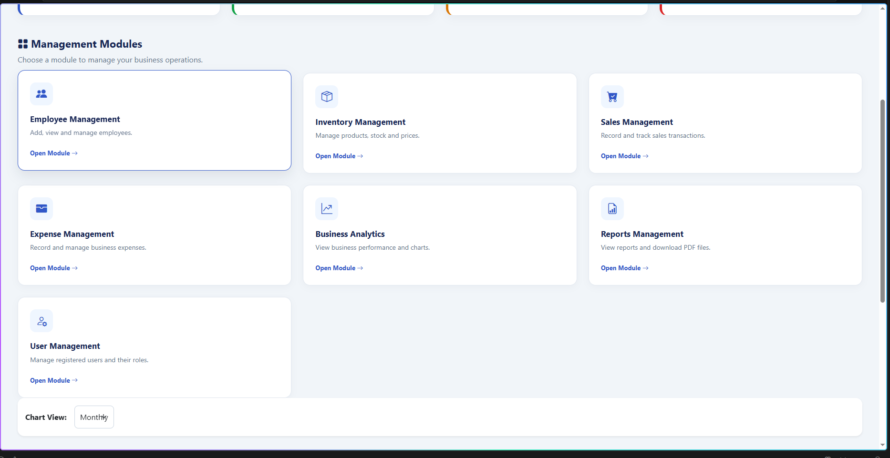
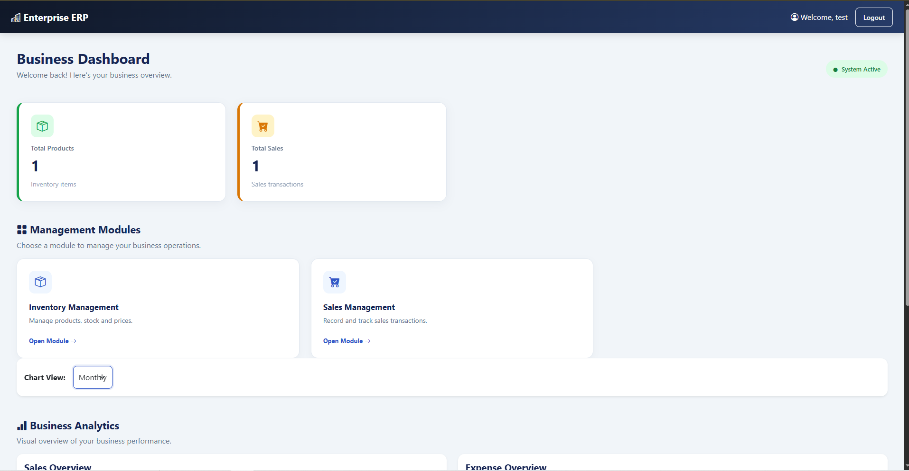

# Enterprise ERP & Analytics Platform

A web-based Enterprise Resource Planning (ERP) and Analytics Platform developed using **Python Flask, SQLite, SQLAlchemy, Bootstrap, HTML, CSS, and JavaScript**.

## 📌 Project Overview

The Enterprise ERP & Analytics Platform is designed to simplify business operations through a centralized web application.

It helps organizations manage employees, inventory, sales, expenses, users, and business analytics with secure role-based access.

## 🚀 Features

### 1. User Authentication
- User Registration
- Secure Login and Logout
- Password Hashing
- Role-Based Access Control

### 2. Employee Management
- Add Employees
- View Employee Details
- Edit Employee Details
- Delete Employees

### 3. Inventory Management
- Add Products
- View Products
- Edit Product Details
- Delete Products
- Track Product Stock

### 4. Sales Management
- Record Sales
- View Sales Records
- Track Sales Information

### 5. Expense Management
- Add Expenses
- View Expense Records
- Manage Business Expenses

### 6. Dashboard & Analytics
- Interactive Dashboard
- Sales Analytics
- Expense Analytics
- Monthly and Yearly Filters
- Interactive Charts using Chart.js

### 7. Reports
- Generate Business Reports
- Export Reports in PDF Format

### 8. User Management
- View Registered Users
- Manage User Roles
- Admin-Only User Management

## 📸 Screenshots

### Admin Dashboard (ADM)



### Employee Dashboard (EMP)



## 🛠️ Technologies Used

| Technology | Purpose |
|---|---|
| Python | Backend Programming |
| Flask | Web Framework |
| SQLite | Database |
| SQLAlchemy | Database ORM |
| HTML5 | Web Page Structure |
| CSS3 | Styling |
| Bootstrap | Responsive UI |
| JavaScript | Interactivity |
| Chart.js | Data Visualization |
| ReportLab | PDF Report Generation |

## 📂 Project Structure

```text
enterprise_erp_analytics/
│
├── app.py
├── config.py
├── models.py
├── requirements.txt
├── README.md
├── .gitignore
│
├── img/
│   ├── adm.png
│   └── emp.png
│
├── templates/
│   ├── base.html
│   ├── login.html
│   ├── dashboard.html
│   ├── employees.html
│   ├── add_employee.html
│   ├── edit_employee.html
│   ├── products.html
│   ├── add_product.html
│   ├── edit_product.html
│   ├── sales.html
│   ├── add_sale.html
│   ├── expenses.html
│   ├── add_expense.html
│   ├── analytics.html
│   ├── reports.html
│   └── users.html
│
└── static/
    ├── css/
    │   └── style.css
    └── js/
        └── script.js
```

## ⚙️ Installation & Setup

### 1. Clone the Repository

```bash
git clone YOUR_GITHUB_REPOSITORY_URL
```

### 2. Navigate to Project Folder

```bash
cd enterprise_erp_analytics
```

### 3. Create Virtual Environment

```bash
python -m venv venv
```

### 4. Install Dependencies

```bash
pip install -r requirements.txt
```

### 5. Run the Application

```bash
python app.py
```

### 6. Open in Browser

```text
http://127.0.0.1:5000
```

## 👥 User Roles

| Role | Permissions |
|---|---|
| Admin | Access to all modules and management features |
| Employee | Access to Dashboard, Inventory, and Sales |

## 🔮 Future Enhancements

- Advanced Business Analytics
- Excel Report Export
- Email Notifications
- Advanced Inventory Tracking
- Improved User Interface

## 👨‍💻 Developer

**Rohan Pawar**

Enterprise ERP & Analytics Platform

*Developed as an internship project.*